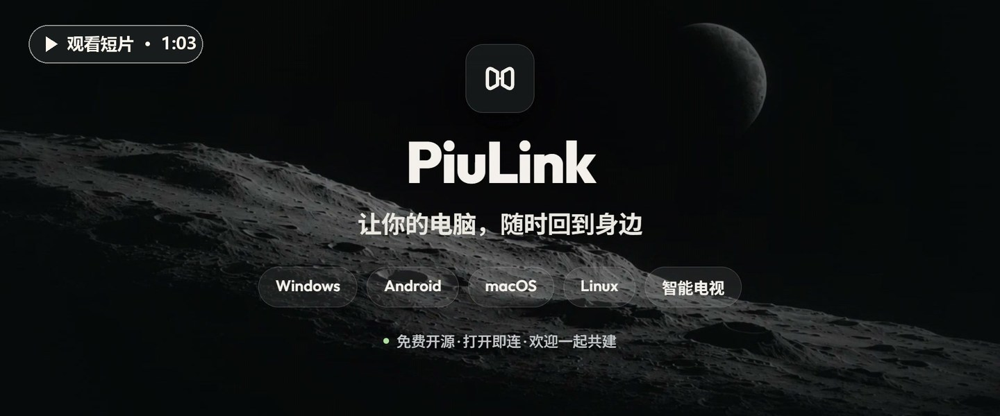

# PiuLink

PiuLink 让你从手机、平板、电视或另一台电脑连接自己的电脑，远程使用桌面和应用，也可以用手柄玩游戏。主机端基于 Sunshine，客户端兼容 Moonlight。分辨率、画面比例和帧率取决于显示器、编解码硬件和网络条件。

[](https://atipiu.github.io/PiuLink-Community/#film)

[观看短片（1:03）](https://atipiu.github.io/PiuLink-Community/#film) · [前往官网下载](https://atipiu.github.io/PiuLink-Community/#downloads)

## PiuLink Rust 全新主线

PiuLink Rust 是完全全新的开发版本。自本次发布起，后续优化、修复和功能迭代统一基于新的 main。旧版 fork、旧版 commit 和基于旧主线的 PR 均不接受合并。希望继续贡献的开发者，请从新的 main 创建新的 fork 或分支，重新实现所需改动并提交新的 PR。

[本次大版本说明](https://github.com/ATIpiu/PiuLink-Community/releases/tag/rust-2026.11.28) · [Rust 串流核心](engines/rust/) · [贡献说明](CONTRIBUTING.md) · [旧主线存档](https://github.com/ATIpiu/PiuLink-Community/tree/history/pre-rust-main-20261127)

## 下载与连接

| 设备 | Rust 主线安装包 |
| --- | --- |
| Windows 整合版 | [0.2.142 · 首次安装小包](https://github.com/ATIpiu/PiuLink-Community/releases/download/windows-0.2.142/PiuLink-Windows-0.2.142-win-x64-compact.exe) · [标准 EXE](https://github.com/ATIpiu/PiuLink-Community/releases/download/windows-0.2.142/PiuLink-Windows-0.2.142-win-x64.exe) |
| Windows 控制端 | [0.2.41 · MSI](https://github.com/ATIpiu/PiuLink-Community/releases/download/rust-2026.11.28/PiuLink-Client-0.2.41-win-x64.msi) |
| Windows 被控端 | [0.2.138 · MSI](https://github.com/ATIpiu/PiuLink-Community/releases/download/rust-2026.11.28/PiuLink-Host-0.2.138-win-x64-preview.msi) |
| Android | [0.3.264 · 通用 APK](https://github.com/ATIpiu/PiuLink-Community/releases/download/android-0.3.264/PiuLink-Android-0.3.264-nonRoot-universal-release.apk) · [ARM64 精简 APK](https://github.com/ATIpiu/PiuLink-Community/releases/download/android-0.3.264/PiuLink-Android-0.3.264-nonRoot-arm64-v8a-release.apk) |
| Linux 整合版 | [0.1.1 · DEB](https://github.com/ATIpiu/PiuLink-Community/releases/download/rust-2026.11.28/piulink-suite_0.1.1-1_amd64.deb) |
| 鸿蒙模拟器 | [0.1.7 · API 24 未签名 HAP](https://github.com/ATIpiu/PiuLink-Community/releases/download/rust-2026.11.28/PiuLink-Harmony-0.1.7-API24-emulator-unsigned.hap) |

iOS 提供集成源码，macOS 本轮留空。各平台验证范围见版本说明。

1. Windows 默认安装整合版。想让其他设备连接这台电脑时，打开 PiuLink Host。想用这台电脑控制其他主机时，打开 PiuLink Client。Android 手机、平板和电视默认选择通用版。
2. 第一次连接建议让两台设备使用同一局域网。在客户端发现或手动添加电脑，按提示在 Host 确认配对。
3. 选择「桌面」或已配置的游戏、应用开始串流。Windows Host 与各客户端均可直接启动，局域网使用无需 PiuLink 账号。
4. 异地使用可手动添加可达地址、使用自己配置的 Tailscale，或在支持的版本上使用 Host 生成的私有邀请。邀请服务用于发现地址和协商直连，目前属实验功能。PiuLink 不提供音视频中转。

在 Android 客户端的「设置 → 触控 → 触控板鼠标速度」可选 0.5× 至 4×。串流中也可从菜单直接调速，选择后立即生效。此设置作用于触控板模式下的单指移动与拖动。

全新 Windows 电脑安装 Host 后，麦克风回传还需要适用的 PiuLink 虚拟麦克风驱动。已有 PiuLink 录音设备的电脑可以在 Android 串流菜单点「开启远端麦克风」、授予录音权限，并在远端会议或录音应用中选择相应的输入。[虚拟麦克风驱动与打包说明](apps/windows-host/audio-driver/README.md)

## 各平台能做什么

| 平台 | 用途与进展 |
| --- | --- |
| Windows Host | 捕获桌面和应用、配对客户端、选择实体或虚拟屏、恢复显示布局。支持配对设备传文件和兼容录音设备上的麦克风回传。 |
| Windows Client | 管理主机、启动桌面与游戏、设置串流画质，提供图形界面和命令行。 |
| Android 手机、平板、电视 | 桌面和游戏串流、键鼠、触控、手柄。手机和平板另有桌面快捷栏、文件互传、麦克风回传和 SSH 终端。 |
| Linux Host / Client | 控制端提供 amd64 和 arm64 的 DEB 及便携压缩包，需另装 Moonlight Qt。Ubuntu 26.04 amd64 被控端也提供 DEB 及压缩包。 |
| macOS | 0.1.7 支持邀请链接 P2P 打洞。未在 Mac 真机上验证。当前提供未签名、未公证的预览包，依赖 Moonlight.app。 |
| iOS / iPadOS | 0.1.4 提供 ARM64 未签名 IPA，支持 iOS / iPadOS 15 及以上。iPhone 模拟器完成桌面影音和输入验证；真机安装前需自行签名。 |
| HarmonyOS NEXT | 原生客户端 0.1.2 提供 ARM64 / x86_64 未签名 HAP。支持局域网 PIN 配对，已在 DevEco Studio 手机模拟器验证桌面影音和输入。 |

主播目前预算有限，手头没有用于实测的苹果设备。

Windows 主链路和 Android 已有真机串流验证。直连邀请在部分家庭网络上仍会超时；使用已知地址或局域网发现可以独立于邀请服务连接。当前集成引擎标记为开发版本。

## 源码与构建

| 入口 | 内容 |
| --- | --- |
| [Windows 整合版](apps/windows-suite/README.md) · [Windows Host](apps/windows-host/README.md) · [串流引擎](apps/stream-engine/README.md) | 主机源码、引擎固定版本及补丁、安装器和验证脚本 |
| [Windows Client](apps/windows-client/README.md) · [命令行](docs/CLI.md) | Windows 客户端、Qt 引擎集成、配对与串流命令 |
| [Android](apps/android/README.md) | 随仓库提供的 Android 源码、原生依赖和签名构建入口 |
| [Linux Host](apps/linux-host/README.md) · [Linux Client](apps/linux-client/README.md) · [macOS](apps/macos-client/README.md) · [iPhone](apps/ios-client/README.md) | 平台要求、实现及打包入口 |
| [共享客户端库](packages/client-core/README.md) · [直连传输](packages/direct-tunnel) · [邀请服务](services/rendezvous) | 主机记录、连接协议、客户端与服务端实现 |

在 Windows 安装 .NET 8 SDK、PowerShell 7 和 Go（直连传输使用 Go 1.26.6 工具链）后，从仓库根目录执行：

```powershell
pwsh ./tools/Check-Project.ps1
pwsh ./tools/Check-Project.ps1 -Build -Tests
```

第一条检查项目引用和文档链接，第二条编译并运行现有 .NET 测试。Android 和原生核心、enet 源码已一同收录。详见[开发指南](docs/DEVELOPMENT.md)。

## 许可与发布

PiuLink 自有独立组件按 **PolyForm Noncommercial 1.0.0** 授权，可以按许可进行非商业使用、修改和分享。Moonlight、Sunshine 的衍生程序及其对应源码按 GPLv3 分发，第三方组件沿用各自许可。[各组件的许可范围](LICENSE.md)

在 [GitHub Releases](https://github.com/ATIpiu/PiuLink-Community/releases) 下载版本附件和 `SHA256SUMS`。源码目录、平台版本及发布约定见[源码与 Release 说明](docs/PUBLICATION.md)。
